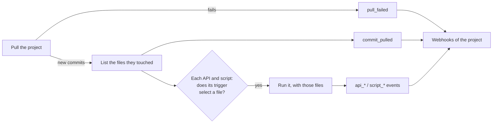

# How it works

Four things are configured:

- A **project** is a git repository this instance keeps a checkout of and pulls.
- An **API** item calls an API when a project changes, with the files that changed.
- A **script** item runs a file from a repository when a project changes, with what changed in its
  environment.
- A **webhook** tells a receiver what happened: a pull, an API run, a script run.

Every item that acts or tells watches one project. Nothing else is in git: the repository holds
whatever the items read (JSON users, DNS zones, playbooks), in whatever layout suits it.

## A pull, and what it starts



1. **A project is pulled** on its `sync_interval_seconds` or cron `schedule`, at boot, or on
   demand (`POST /api/v1/projects/{id}/sync`, what a pipeline calls after pushing). A first clone
   starts nothing: there is nothing to compare it with.
2. **A pull that brings commits lists the files they touched** (added, changed or removed).
3. **Each API and script watching that project** whose trigger runs `on: change` and whose
   `paths` select one of those files **runs, with those files only**. A file another item's paths
   select runs that item too; a commit touching nothing an item watches does not run it.
4. **The pull and every run are told** to the project's webhooks that want the event.

A run that cannot list what came in (git could not say) runs every item of the project, rather than
silently none.

## Triggers

```yaml
trigger:
  paths: [users/*.json]          # globs; left out: every file
  ignore_paths: ["**/*.md"]      # wins over paths
  on: [change, manual]           # the default; also startup and schedule
  schedule: "0 3 * * *"          # cron, with schedule in `on`
  debounce_seconds: 30           # gather quick commits into one run
```

| `on` | When | Which files |
| --- | --- | --- |
| `change` | A pull brought commits touching a selected file | Those the commits touched |
| `startup` | The process started, after its first pulls | Every selected file in the checkout |
| `schedule` | Every occurrence of `schedule` | Every selected file in the checkout |
| `manual` | `POST /api/v1/{apis,scripts}/{name}/run` | Every selected file in the checkout |

- **Globs** are by path segment: `*` stays inside one, `**` spans any number (none included), `?`
  is one character. `users/*.json` does not match `users/team/a.json`; `users/**` does.
- **A debounce** holds a change back that long and adds the changes that arrive meanwhile: three
  quick pushes make one run with the files of all three.
- **A dry run** (`?dry_run=true` on a run) is always allowed. It builds every request or command
  and writes nothing: an API's reads (compare, upsert's exists) are made, its writes are not; a
  script is not run.

## Runs

- **One at a time per item.** A run that starts while the item's previous one is still going waits
  for it, so two commits never interleave their requests to one system.
- **Kept.** Each item keeps its last 50 runs in memory: why it ran, by whom, at which commit (and
  for a script, the commit of its own repository), how long it took, and every step: the file, what
  was done, the status or exit code, the error. `GET /api/v1/apis/{name}` and
  `GET /api/v1/scripts/{name}` show them; a restart starts the history over.
- **Told.** A run that works is `api_succeeded` / `script_succeeded`; one that fails is
  `api_failed` / `script_failed`; the first that works after failures is also `api_recovered` /
  `script_recovered`.
- **A failure does not stop the others by default.** With `on_failure: stop`, a failed file ends
  the run there.

## Pulls

| Event | When |
| --- | --- |
| `commit_pulled` | A pull brought commits (with `trigger.paths`, only those touching a selected file) |
| `pull_failed` | The repository could not be pulled: once, when the project starts failing |
| `pull_recovered` | Pulls work again after failing |

While pulls fail, nothing runs on a change: the checkout stays at the commit it has, and a
scheduled or manual run uses that commit.

## What stays out of git

An item's connection to a system (its URL, its credential, its auth) is in the configuration
directory admins own, never in the watched repository: whoever can merge there decides what is
sent, not where it goes or as whom. A script's file may live in a separate repository
(`script.project`) with stricter reviewers than the data it reads.
