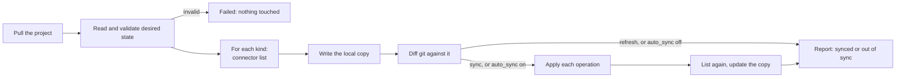

# How it works

Two things are configured, and one thing lives in git:

- A **connector** is a script that knows one type of system, and describes the object types it
  manages there.
- An **application** is one live system and its desired state: the connector that reaches it, with its
  own address and credentials, and a folder in a git project, reconciled as one unit.
- **Desired state** is YAML in that folder: each file lists the objects of one kind.

```yaml
# apps/isilon-prod/nfs-exports.yaml, in the application's git project
kind: nfs_export
items:
  - path: /ifs/data/projects
    clients: [10.0.0.0/24]
    read_only: false
```

## The loop

Each application is checked every `sync_interval_seconds`, and on demand (`refresh`, `sync`):



1. **Pull.** The project is pulled first, on every run (scheduled, Check or Sync), so a commit is
   picked up at the next check and a Sync right after a commit applies it. A failed pull
   is recorded on the project and the check goes on against the checkout already on disk.
2. **Validate.** Every file is parsed and checked before anything else happens: a kind the
   application's connector manages, every object carrying the kind's key, no key declared twice. Any
   error fails the run; the system is not listed or changed.
3. **List.** For each kind in the files, the connector lists what exists now. The answer is
   written to the local copy (see below) and the diff is taken against it.
4. **Diff.** Objects are matched on the kind's `key`. Only the fields git declares are compared, so
   the defaults a system returns are never drift. Nested objects follow the same rule; lists and
   scalars are compared whole.
5. **Apply** (sync, or a check with `auto_sync`). Each operation goes to the connector one at a time:
   creates and updates in `depends_on` order, deletes after them in reverse. A failed operation does
   not stop the others; the run is `partial`.
6. **List again.** What was touched is listed once more, so the local copy and the reported status
   show what the system has after the apply, not what was sent.

## The local copy of each system's settings

`state.dir/<application>/<kind>.yaml` holds what the system had at its last check, in the same format as
a desired-state file. It is refreshed from the system on every check, never only from what this tool
wrote, so a change made by hand appears there too. Two uses:

- Diff it against git with any tool, or read it in the UI and at `GET /api/v1/applications/{id}/state/{kind}`.
- Bring an existing system under management: copy the file into git and edit it down.

## Rollback

`POST /api/v1/applications/{id}/rollback` with `{"revision": "<commit>"}` (the Rollback button on a
past sync in the UI) applies the desired state of an older commit, once, the way a sync applies
HEAD. The checkout stays at HEAD: the commit's folder is exported beside it, fetching history first
if the shallow checkout does not have it.

Git still says HEAD afterwards, so the application is marked rolled back and checks stop applying,
`auto_sync` or not; otherwise the next check would put HEAD straight back. Checks go on comparing,
and report the application out of sync with git. The mark is kept in the state folder, so a restart
does not lift it. The next manual Sync applies HEAD again and ends it. To make a rollback last, revert
the commit in git, then Sync.

## Statuses

| Application status | Meaning                                                                  |
| ------------------ | ------------------------------------------------------------------------ |
| `synced`           | Every declared object exists exactly as declared                         |
| `out_of_sync`      | The last check found operations to do: new commits, or drift made by hand |
| `failed`           | The last run could not finish: invalid desired state, a connector error     |
| `unknown`          | Not checked yet                                                          |
| `rolled_back`      | Rolled back to an older commit: automatic syncs paused until a manual Sync |

| Run result    | Meaning                                                                       |
| ------------- | ----------------------------------------------------------------------------- |
| `succeeded`   | Nothing to do, or every operation applied                                     |
| `out_of_sync` | A check (no apply) found operations                                           |
| `partial`     | An apply where some operations failed; the next run picks up from what is there |
| `failed`      | The run could not finish                                                      |

## Safety rules

- **No automatic writes by default.** `auto_sync: false` means a check only reports; a person (or a
  pipeline) presses Sync.
- **No deletes by default.** With `prune: false`, an object on the system that git does not declare
  is listed as *unmanaged* and left alone. With `prune: true` it is deleted.
- **An application only owns what it declares.** Kinds its files never mention are not listed or
  touched, and its files cannot name another system: where the writes go is the configuration's
  to say, not the repository's.
- **One lock per application.** A scheduled check and a manual Sync never interleave. Two
  applications pointed at the same system are not serialised against each other, so give them
  different kinds.
- **Every connector run is bounded.** A connector that hangs is killed at its `timeout_seconds`.
- **Connectors can only write when asked to.** `UNIFIED_ALLOW_WRITE=1` is set only on `apply`; the SDK
  refuses to write without it.
